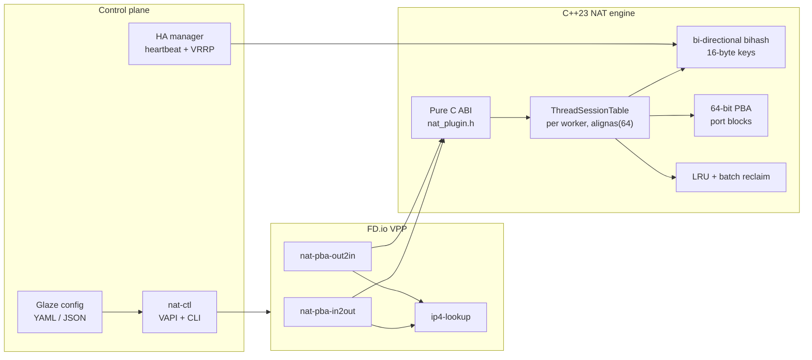

# NAT44 PBA Data Plane for FD.io VPP

A carrier-grade NAT44 data plane built as an FD.io VPP plugin, with a modern
C++23 session engine behind a pure C ABI.

[](https://en.cppreference.com/w/cpp/23)
[](https://fd.io/)
[](LICENSE)

## Overview

`nat` implements deterministic NAT44 translation with 64-port block allocation
(PBA), per-worker session sharding, vectorized packet batches, and snapshot-based
HA session synchronization. The data plane is a VPP graph plugin; the session
engine is a C++23 library isolated from VPP headers by an ISO C interface.

The project is designed for:

- exact-match IPv4 NAT44 with TCP, UDP, and ICMP echo translation;
- 64-bit PBA port allocation with multiple public IPs per worker;
- per-worker session tables with no cross-worker data sharing;
- batch lookup, batch create, and batch eviction;
- operational control through `nat-ctl`, VPP CLI, and binary API;
- active/standby HA with session snapshot synchronization.

## Architecture



### Data-plane design

- **Shared-nothing workers.** Each VPP worker owns a `ThreadSessionTable`
  aligned to 64 bytes. There are no cross-worker session locks or shared
  counters in the packet path.
- **Bi-directional exact-match tables.** `in2out` and `out2in` use VPP
  `clib_bihash_16_8`. Bucket capacity is sized from the expected active set,
  not from the maximum allocation capacity.
- **PBA port allocation.** Ports are allocated in 64-port blocks from 64-bit
  bitmaps using `__builtin_ctzll`. Each worker can own multiple public IPs;
  block metadata records the public-IP index.
- **Vector batches.** The direct-call benchmark exercises batches of up to 256
  packets. The batch path performs hash/prefetch, lookup, and create/evict as
  separate phases to expose memory-level parallelism.
- **Lazy state updates.** Optional lazy timestamp mode avoids a dirty
  cache-line write on every packet; the default remains exact per-packet
  accounting.
- **Experimental inline values.** An optional fast path stores translation
  metadata in the hash value and a compact state array. It is disabled by
  default and is intended for measurement only.
- **HA synchronization.** `nat_ha_sync` sends session snapshots from active to
  standby over TCP, keeps a shadow map, and imports it on promotion.

## Build

### Prerequisites

- Linux x86-64, Ubuntu 22.04/24.04 or equivalent;
- FD.io VPP 26.06+ with development headers and `vpp-plugin-core`;
- GCC 13+ or Clang 18+ with C++23 support;
- CMake 3.28+, Ninja;
- optional: pixi for the pinned development environment.

### Release build

```bash
cmake --preset release
cmake --build --preset release -j"$(nproc)"
ctest --test-dir build --output-on-failure
```

The plugin is produced at `build/lib/vpp_plugins/nat_pba_plugin.so`.
The control daemon is produced at `build/nat-ctl`.

### Hugepages and test topology

```bash
sudo bash config/setup_hugepages.sh
sudo bash config/setup_subnets.sh
```

## Configuration

`nat-ctl` reads the same configuration schema from YAML or JSON:

```bash
./build/nat-ctl --config config/config.yaml --node node1
./build/nat-ctl -c config/config.json -n node2
```

The relevant VPP plugin settings are applied through the plugin CLI:

```text
nat pba set sessions <per-worker>
nat pba set pool <start-ip> <end-ip>
nat pba set block-size <32|64>
nat pba set max-blocks <1..8>
nat pba set timeouts udp <s> tcp-established <s> tcp-transitory <s> icmp <s>
set interface nat pba in <interface>
set interface nat pba out <interface>
show nat pba config
show nat pba
```

HA control:

```text
nat pba ha set role active|standby|off
nat pba ha set local <ip> <port>
nat pba ha set peer <ip> <port>
nat pba ha start
nat pba ha promote
show nat pba ha
```

## Benchmark methodology

All figures below were collected with the direct-call harness
`tests/bench_real_churn_10s` on:

- AMD Ryzen 7 6800H, 8 physical cores / 16 threads, 16 MB L3, dual-channel DDR5;
- 64-byte IPv4/TCP uplink packets;
- workers pinned to distinct logical CPUs, `nice -20`;
- all-core frequency pinned to 3.3 GHz with `scaling_min_freq = scaling_max_freq`;
- median of repeat runs; churn success is reported so an invalid run is visible.

This harness measures the NAT engine directly. It does not exercise a NIC,
DPDK RX/TX queues, or the VPP graph scheduler.

### Strong scaling reference

Fixed workload: **100,000 active sessions**, 0% churn. This isolates lookup and
working-set behavior because the session table fits in L3.

| Workers | Sessions/s | Scaling | Target envelope |
|---:|---:|---:|---:|
| 1 | 18.58 M | 1.00× | — |
| 8 | 141.62 M | 7.62× | ≥ 70 M |
| 16 | **168.74 M** | **9.08×** | ≥ 130 M |

The 8- and 16-worker points exceed the 70 M / 130 M target envelope. A single
worker cannot reach 70 M sessions/s for this workload; the measured ceiling is
in the high-teens to low-twenties of millions of sessions per second.

Working-set scaling confirms the memory boundary:

| Active sessions | Workers | Sessions/s | Cycles/packet |
|---:|---:|---:|---:|
| 100k | 16 | 168.74 M | 300 |
| 1M | 16 | 142.02 M | 357 |
| 4M | 16 | 134.39 M | 377 |

At 100k sessions the table fits in L3 and the engine scales to 9.08×. At 1M/4M
the working set exceeds L3, throughput drops, and cycles per packet rise. This
is a memory-hierarchy limit, not a lock or sharding limit.

### 15% churn reference

Telecom-style churn, 64B, 1,024,000 active sessions, balanced power profile:

| Workers | Production (lazy off) | Tuned (lazy on) |
|---:|---:|---:|
| 1 | 15.23 M sessions/s | 15.75 M |
| 8 | 58.44 M | 62.87 M |
| 16 | 70.12 M | **75.72 M** |

Churn attempts remain 15.00% and churn success is 15.00% in these runs.
The 15% churn path includes create, evict, and delete work, so its scaling is
lower than the 0% strong-scaling reference.

### Reproduce

```bash
# Strong scaling, 100k active, 0% churn, 16 workers
sudo env NAT_BENCH_CHURN=0 \
  NAT_BENCH_TOTAL_SESSIONS=100000 \
  NAT_BENCH_MAX_SESSIONS=6250 \
  NAT_BENCH_BATCH=256 \
  NAT_BENCH_LAZY=1 \
  ./build/tests/bench_real_churn_10s 64-up 5 16

# 15% telecom churn, 1.024M active, 16 workers
sudo env NAT_BENCH_CHURN=15 \
  NAT_BENCH_POOL=30000 \
  NAT_BENCH_MAX_SESSIONS=64000 \
  NAT_BENCH_BATCH=256 \
  NAT_BENCH_LAZY=1 \
  ./build/tests/bench_real_churn_10s 64-up 10 16
```

## Tests

```bash
ctest --test-dir build --output-on-failure
```

The suite covers:

- PBA bitmap allocation and release;
- configuration parsing through Glaze;
- per-worker session create/lookup/delete and replacement protection;
- ICMP, fragment, malformed packet, and TCP state handling;
- HA snapshot import/export and a two-process transport test;
- batch lookup and hash-backend microbenchmarks.

Optional experimental builds:

```bash
# Flat 16-byte hash backend
cmake --preset release-flat
cmake --build --preset release-flat -j"$(nproc)"

# Profile attribution build
cmake -B build-prof -G Ninja -DCMAKE_BUILD_TYPE=Release \
  -DNAT_PROFILE_NOINLINE=ON
cmake --build build-prof -j"$(nproc)"
```

## Repository layout

```text
.
├── CMakeLists.txt / CMakePresets.json
├── config/                 # VPP, topology, hugepage, and HA configuration
├── include/nat/            # C ABI and session types
├── src/control/           # nat-ctl control daemon and HA manager
├── src/plugin/            # VPP plugin, session engine, bihash, PBA
├── tests/                 # unit, integration, HA, and benchmark harnesses
├── pixi.toml / pixi.lock  # pinned development environment
└── README.md
```

## Operational limits

- One public IP provides 64,512 usable ports. A worker's active session count is
  bounded by its public-IP count and the per-subscriber block quota.
- The engine currently supports up to four public IPs per worker. Larger active
  sets require additional public IPs and corresponding configuration.
- The VPP graph path and the direct-call benchmark are separate execution paths;
  numbers from one must not be presented as numbers from the other.
- Experimental lazy, inline, hot-cache, and flat-hash paths are opt-in. They are
  not enabled by default and must be validated for the target workload.

## License

Licensed under the Apache License, Version 2.0. See [LICENSE](LICENSE).
